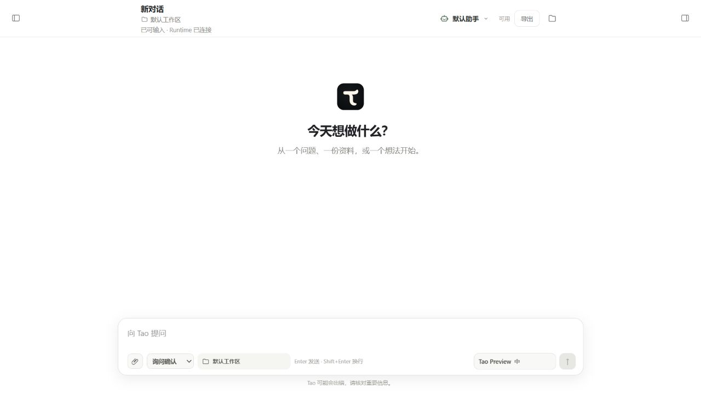

# Tao

**可定制、可协作、可观察的桌面智能体工作台。**

Tao 把角色提示词、工具和权限保存为可复用的「智能体组合」。你可以为不同会话或项目选择组合，让多个成员分工、交流和复核，并随时查看执行过程、补充要求或停止任务。

我们的目标是让搭建垂类智能体更简单：把需要模型判断的环节交给智能体，把确定的业务操作封装成工具，逐步连接成适合自己的工作方式。

[下载安装](https://github.com/1newbird/Tao/releases/latest) · [功能指南](docs/项目手册/12-功能指南.md) · [源码运行](#从源码运行) · [开发计划](docs/开发TODO.md)



*新对话界面，侧栏已收起；使用模拟配置。*

## 现在可以做什么

| 能力 | 使用方式 |
|---|---|
| **定制智能体组合** | 设置角色、附加要求、工具、权限、默认模型和 Skills 开关；按会话选择，也可设为项目默认。 |
| **接入自己的工具** | 在共享工具库定义程序、Shell 或 HTTP 工具，配置输入参数结构，再加入需要的组合；支持组合导入导出。 |
| **联网检索与读取网页** | 分别配置 Brave / SearXNG 搜索和公开网页读取；会话能力摘要明确展示配置与权限限制。 |
| **连接 MCP 与安装 Skills** | 连接远程 Streamable HTTP MCP 并授权指定工具；本地导入或从公开 GitHub 安装技能，按组合选择。 |
| **读取 PDF / DOCX** | 上传附件或指定本地文档，通过 read 提取文本与表格；无需 Office，扫描件 OCR 尚未支持。 |
| **组织多智能体协作** | 派发不同角色的成员并行执行、定向交流，共享任务板支持认领、依赖、结果验收、重试与取消。 |
| **查看和介入成员任务** | 查看成员对话、执行摘要、协作消息和任务历史；可打开独立查看窗口、补充说明、追加任务或停止执行。 |
| **看清提示词与上下文** | 预览默认提示词及组装来源；会话中查看首次记录的 SDK 输入，区分系统指令、消息概况和工具定义。 |
| **配置工具执行边界** | 按组合选择本机、Docker 或 Windows 原生沙盒预览，设置文件范围、工作区只读、联网和凭据名单。 |
| **定制上下文压缩** | 设置自动压缩、近期保留量和摘要补充要求，主会话与成员各自使用组合快照。 |
| **在工作区持续对话** | 配置模型服务，使用附件、文件预览、Git Diff 和权限确认；流式生成时可上翻历史，消息支持 Markdown 与复制。 |

### 把配置变成可复用的能力

在「定制」中创建组合，保存提示词和工具选择，再从会话顶部切换。工具定义由多个组合共享，启用范围和权限按组合管理。

已有会话保留配置快照。修改组合后，由你在会话中点击「应用新版组合」，不会悄悄改变正在运行的任务。需要全新的上下文时，可以新建会话或点击「测试组合」。

### 让协作过程可以检查

主智能体可以把任务交给拥有独立上下文的成员。成员能分享发现、提出问题和认领后续任务；前置任务通过验收后，下游任务才会开放执行。

在右侧「工作过程 → 协作成员」中选择成员，中间区域显示其详情。「独立窗口」打开同一个成员的查看页，不创建另一份任务。补充说明会在下一次模型调用前送达；关闭查看页不会停止任务。

### 让上下文组成可以解释

在「定制 → 系统提示词」中查看默认内容、组成与来源，以及自定义配置的合成预览。实际工作区、权限和环境信息在运行时绑定。

会话右侧的「上下文」保存首次记录的 SDK 输入。完整工具说明与参数结构通过独立的 `tools` 字段提供，系统指令只保留工具短索引与指导。这里展示的是 SDK 输入记录，不是供应商最终 HTTP 请求或隐藏推理。

## 下载安装

当前提供 **Windows 10/11 x64** 安装包。

1. 前往 [最新 Release](https://github.com/1newbird/Tao/releases/latest)，下载 `.msi` 安装包并安装。
2. 打开 Tao，在「设置 → 模型与 Provider」填写服务地址、模型与认证，保存并测试连接。
3. 新建对话，选择工作区与组合，输入任务开始使用。

**普通用户无需安装 Node.js、Rust 或开发工具链**，安装包已包含应用运行所需的 Node 和后台资源。缺少 WebView2 时，安装程序可能需要联网获取它。当前安装包尚未签名，Windows 可能提示未知发布者。

工具调用仍有各自的外部依赖：本机命令工具需要可用的 Bash（例如 Git Bash）；Windows 原生预览使用系统 PowerShell，首次需管理员初始化；Docker 后端需安装 Docker Desktop，可在“定制 → 执行与沙盒”按随包配方准备 Tao 基础镜像（约 867 MiB，首次需下载）。本地文件检索工具可能需要获取 `rg`、`fd`；自定义工具依赖的程序或服务也需要可用。普通模型对话不要求安装 Git 或 Bash。

**模型 API 与搜索服务相互独立。** 搜索默认关闭，需要自己的 Brave 密钥或 SearXNG 实例，本项目暂不提供公共搜索服务。网页读取可独立开启；MCP 也需要用户提供可用的服务地址和必要凭据。

配置和会话默认保存在 `%USERPROFILE%\.tao`。模型请求会按配置发送给所选服务商；本地保存数据不代表模型在本地运行。请勿公开认证文件或把 API Key 写进提示词。

## 当前范围与后续方向

Tao 仍在迭代。当前版本已经支持组合定制和一层父子协作，使用时需了解这些边界：

- **协作运行在单机、单 Runtime 中。** 主请求结束或停止时回收未完成成员；重启后不会自动重放未完成任务。历史可查看，不支持跨轮常驻团队或递归派发。
- **成员共用工作区。** 可选 Docker 工具沙盒和无需 Docker 的 Windows 原生预览，默认禁止工具联网；原生方案需管理员准备，仍有工具兼容限制，Windows 10 尚待实机验收。成员文件冲突仍需明确分工，停止或重试不会撤销已发生的操作。
- **上下文支持预览、首次记录与压缩配置。** 可设置自动压缩、近期保留及摘要要求；逐轮完整追踪、团队令牌与费用硬预算仍待开发。详见 [执行与上下文策略](docs/项目手册/13-权限执行沙盒与压缩策略.md)。
- **扩展能力逐步开放。** 已有工具、提示词、Skills 库及远程 MCP 入口；MCP stdio/OAuth、私有技能仓库、可视化工作流编辑器、Extension/Hook 编辑与插件市场尚未实现。

开发顺序与待解决问题见 [开发 TODO](docs/开发TODO.md)。

## 从源码运行

在 Windows x64 的 PowerShell 中，从仓库根目录执行：

```powershell
powershell -NoProfile -ExecutionPolicy Bypass -File .\scripts\setup-dev.ps1
npm.cmd run tauri dev
```

一键脚本检查并补齐 Node.js、Rust、C++ Build Tools、Windows SDK、WebView2 和项目依赖；已有合格组件直接复用。新安装的便携工具和缓存优先放到 `D:\TaoDev`，没有 D 盘时使用 `%LOCALAPPDATA%\TaoDev`。可用 `-ToolsRoot` 指定位置，或用 `-CheckOnly` 仅检查。部分系统组件可能需要管理员授权或重启。

开发启动脚本会读取保存的工具路径。环境、依赖修复和国内网络配置详见 [从零开始配置开发环境](docs/项目手册/03a-从零开始配置开发环境.md)。

| 命令 | 作用 |
|---|---|
| `npm.cmd run tauri dev` | 启动完整桌面开发模式 |
| `npm.cmd run preview:ui` | 使用内存模拟资料预览实际 UI，不连接模型或读写真实用户数据 |
| `npm.cmd run check` | TypeScript 与 Rust 检查 |
| `npm.cmd run test:agents` | 使用隔离配置与本地模拟模型验证 Runtime、权限和协作机制 |
| `npm.cmd run test:ui` | 界面渲染回归 |
| `npm.cmd run build` | 构建前端 |
| `npm.cmd run tao:release` | 准备并校验发布资源，生成 Windows x64 MSI |

安装包输出于 `src-tauri/target/x86_64-pc-windows-msvc/release/bundle/`。完整流程见 [Windows x64 打包发布手册](docs/项目手册/04-Windows-x64-打包发布.md)。用户数据不应进入源码或安装包。

## 文档

- [功能指南](docs/项目手册/12-功能指南.md)：会话、组合、协作、人工介入和上下文查看。
- [组合与工具使用](docs/项目手册/10-智能体组合与工具使用.md)：工具定义、权限规则、配置版本与导入导出。
- [开发环境](docs/项目手册/03a-从零开始配置开发环境.md) · [架构说明](docs/项目手册/02-架构与顶层约束.md) · [项目手册目录](docs/项目手册/README.md)。
- [开发计划](docs/开发TODO.md) · [v0.3.0 更新说明](docs/发布说明/0.3.0.md) · [发布检查清单](docs/GitHub上传与发布检查清单.md)。

## 使用与许可

Tao 原创部分采用 **[PolyForm Noncommercial License 1.0.0](LICENSE)**，版权通知见 [NOTICE](NOTICE)。允许按该条款进行非商业使用、学习、修改和分发；超出许可范围的商业使用需要另行取得授权。

该标准许可还明确允许慈善、教育、公共科研、公共安全或卫生、环保和政府等条款列明的机构使用，不限于个人学习。具体权利与义务以 [完整许可文本](LICENSE) 为准。Tao 是源码公开、非商业许可的项目，不宣称采用 OSI 认可的开源许可。

第三方组件仍按各自许可证授权，Tao 的非商业条款不改变其原有权利。来源与声明位置见 [第三方许可说明](THIRD_PARTY_NOTICES.md)，外部贡献的授权边界见 [贡献说明](CONTRIBUTING.md)。

## 技术来源与致谢

Tao 使用 Tauri、React 和 TypeScript 构建桌面体验；智能体运行层起源于 [Pi](https://github.com/earendil-works/pi)，以固定源码快照纳入仓库并随 Tao 独立维护和演进。原作者版权与 [MIT 许可证](vendor/pi/LICENSE) 保留。感谢这些项目及其贡献者。
